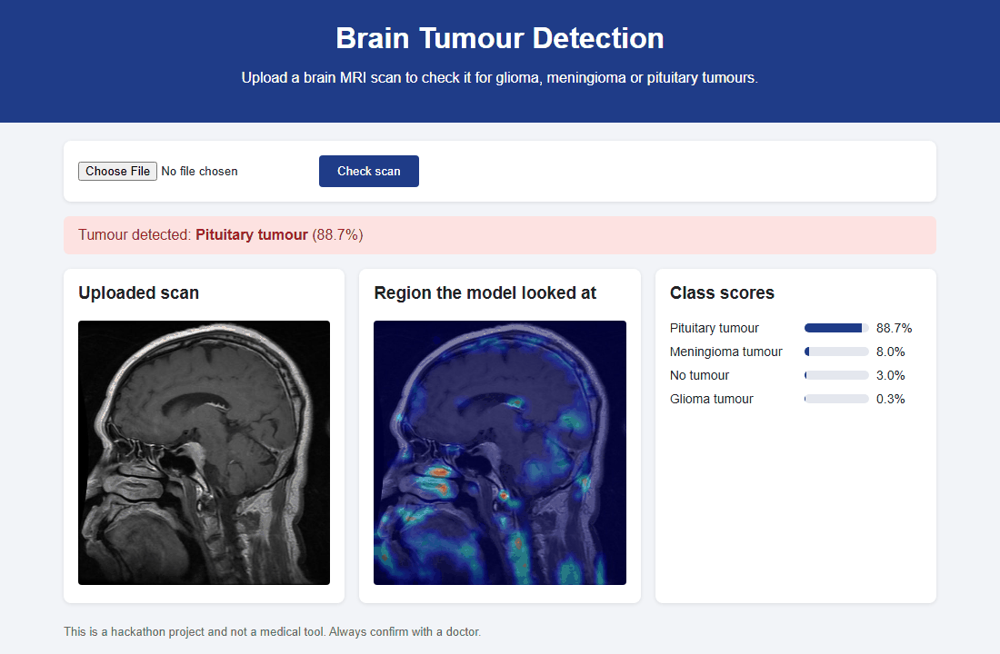

# Round 2 - Brain Tumour Detection from MRI Scans

Problem statement: detect and classify tumours in medical images (X-ray / MRI) to help doctors make faster decisions.

We built a CNN that classifies a brain MRI scan into one of four classes and a Flask web app around it. You upload a scan, the app tells you if it found a tumour and which type it is. When a tumour is found it also shows a Grad-CAM heatmap of the area the model used for its decision.

Classes:

- Glioma tumour
- Meningioma tumour
- Pituitary tumour
- No tumour

## Files

| File | What it is |
| --- | --- |
| `tumour_detection.ipynb` | Training notebook (Google Colab, GPU) |
| `APP.py` | Flask app that loads `tumour.h5` and classifies uploaded scans |
| `templates/index.html`, `static/style.css` | Web page |
| `Team Pixels.pptx` | Our presentation for this round |

## Dataset

[Brain Tumor Classification (MRI)](https://github.com/SartajBhuvaji/Brain-Tumor-Classification-DataSet) by Sartaj Bhuvaji et al. (also on Kaggle). It has `Training` (2870 images) and `Testing` (394 images) folders with one sub folder per class. The dataset is not part of this repo.

## Model

Images are resized to 150x150 and scaled to 0-1. The training images are augmented with shear, zoom and horizontal flip using `ImageDataGenerator`.

```
Conv2D(32, 3x3, relu)  -> MaxPooling2D(2x2)
Conv2D(64, 3x3, relu)  -> MaxPooling2D(2x2)
Conv2D(128, 3x3, relu) -> MaxPooling2D(2x2)
Flatten -> Dense(128, relu) -> Dropout(0.5) -> Dense(4, softmax)
```

Training details:

- 15% of the `Training` folder is held out for validation, `Testing` is only used for the final check
- Adam (learning rate 0.0001) with categorical cross-entropy
- class weights, since `no_tumor` has about half as many images as the other classes
- up to 50 epochs, the epoch with the best validation accuracy is saved to `tumour.h5` and training stops if it doesn't improve for 10 epochs
- at the end the notebook prints the test accuracy and a confusion matrix

## How to run

1. Download the dataset and train the model with `tumour_detection.ipynb`. On Colab, upload the dataset to Drive and change `train_data_dir` / `test_data_dir` to its folders. The notebook saves the model as `tumour.h5`.
2. Put `tumour.h5` in this folder (it is too big for the repo so it is in `.gitignore`).
3. Start the app

```bash
cd "Round 2"
pip install -r requirements.txt
python APP.py
```

4. Open http://127.0.0.1:5000 and upload an MRI image.

Uploaded images and heatmaps are saved in `static/uploads/`.

This was made for a hackathon and is not a medical tool.

## Screenshot

Result for a pituitary tumour scan from the test set:



## Tech stack

Python, TensorFlow / Keras, OpenCV, Flask

## Output video

[](https://youtu.be/J_R62BGdNVM)
